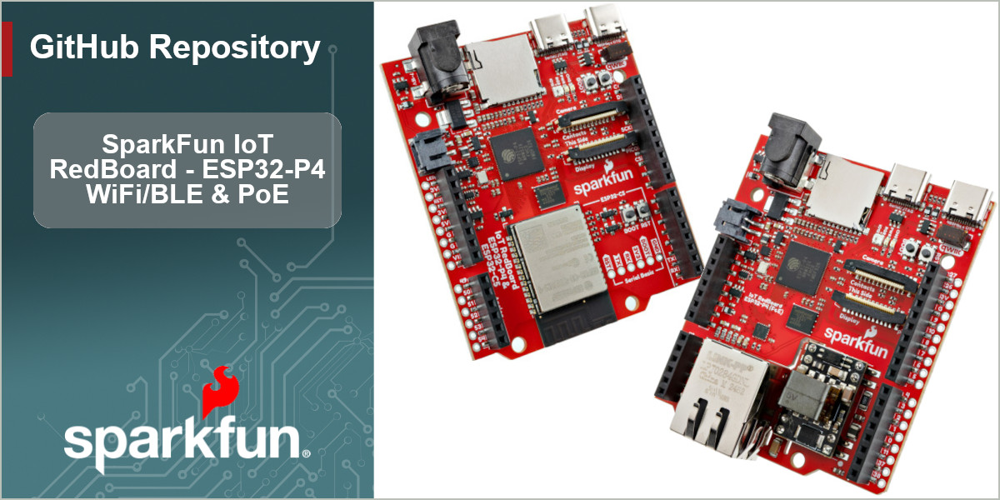

[SparkFun IoT RedBoard - ESP32-P4 & ESP32-C5 (WiFi/BLE)](https://www.sparkfun.com/sparkfun-iot-redboard-esp32-p4-esp32-c5-wifi-ble.html) / [SparkFun IoT RedBoard - ESP32-P4 (PoE)](https://www.sparkfun.com/sparkfun-iot-redboard-esp32-p4-poe.html) 

----------------------------------------

The [SparkFun IoT RedBoard - ESP32-P4 & ESP32-C5 (WiFi/BLE)](https://www.sparkfun.com/sparkfun-iot-redboard-esp32-p4-esp32-c5-wifi-ble.html) & [SparkFun IoT RedBoard - ESP32-P4 (PoE)](https://www.sparkfun.com/sparkfun-iot-redboard-esp32-p4-poe.html)  are two high-performance development boards engineered to tackle demanding edge computing and human-machine interfacing (HMI) applications over a either a wireless or wired connection. The WiFi/BLE version of this IoT RedBoard features an ESP32-C5 modules that handles all wireless communication for the ESP32-P4. The PoE version includes a MagJack connector, 10/100MBps Ethernet transceiver and PoE buck regulator to both connect and power the board over an Ethernet connection.

These IoT RedBoards break out the standard RedBoard/R3 pinout that includes analog pins, digital I/O, I2C, SPI and UART. They also come with a pair of ribbon connectors for compatible MIPI cameras and displays, USB-C connectors for both Serial/JTAG programming and high-speed (480Mbps) USB-2.0 with OTG, a microSD card slot for memeory expansion and a 2-pin JST connector for powering the board with a single-cell LiPo battery. These boards come pre-programmed with MicroPython firmware to get started out of the box running Python but also are supported in the espressif ESP-IDF and the Arduino IDE.

Repository Contents
-------------------

* **/Hardware** - KiCad design files (.brd, .sch)
* **/Arduino** - Arduino patch files for the espressif esp32 Arduino core.
* **/docs** - GitHub pages files for the SparkFun IoT RedBoard - ESP32-P4 Hookup Guide

Documentation
--------------
* **[Hookup Guide](https://docs.sparkfun.com/SparkFun_IoT_RedBoard-ESP32-P4/)** - Basic hookup guide for the SparkFun IoT RedBoard - ESP32-P4.

Product Versions
----------------
* [DEV-30909](https://www.sparkfun.com/sparkfun-iot-redboard-esp32-p4-esp32-c5-wifi-ble.html) - IoT RedBoard - ESP32-P4 & ESP32-C5 (WiFi/BLE)
* [DEV-30910](https://www.sparkfun.com/sparkfun-iot-redboard-esp32-p4-poe.html) - IoT RedBoard - ESP32-P4 (PoE)

License Information
-------------------

This product is _**open source**_! 

Please review the LICENSE.md file for license information. 

If you have any questions or concerns on licensing, please contact technical support on our [SparkFun forums](https://forum.sparkfun.com/viewforum.php?f=152).

Distributed as-is; no warranty is given.

- Your friends at SparkFun.
